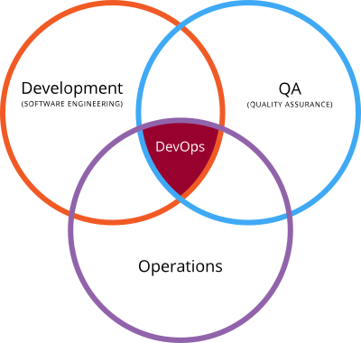
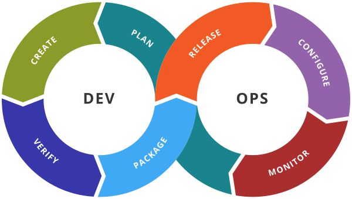
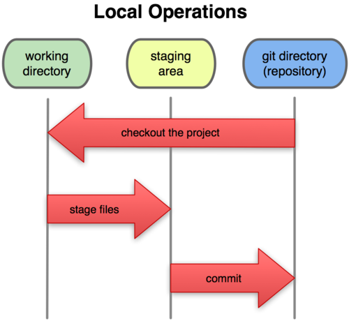
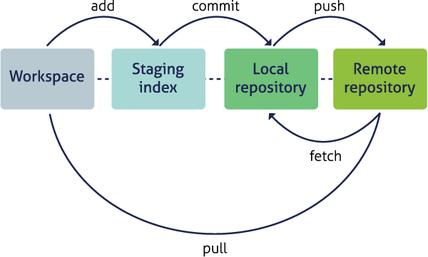
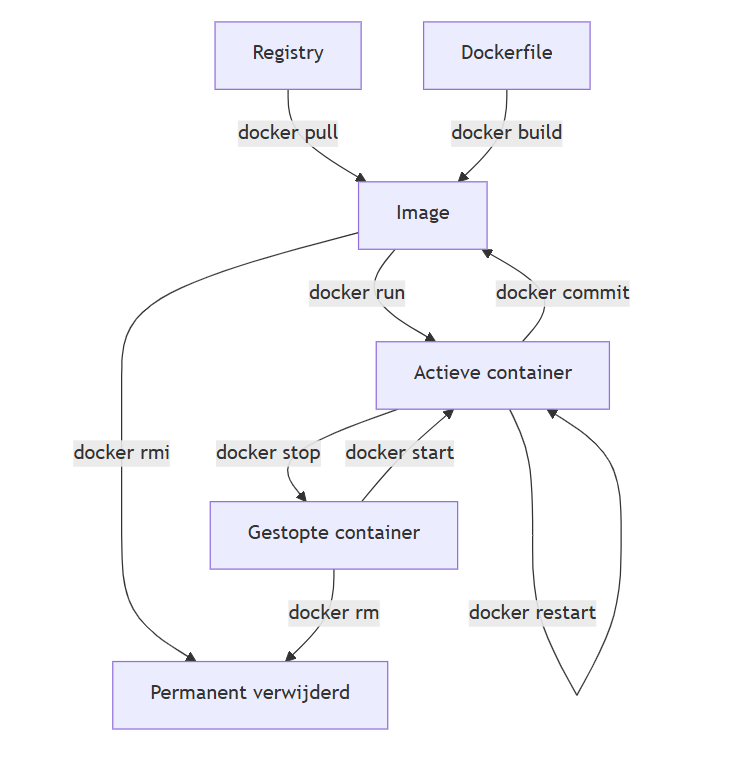
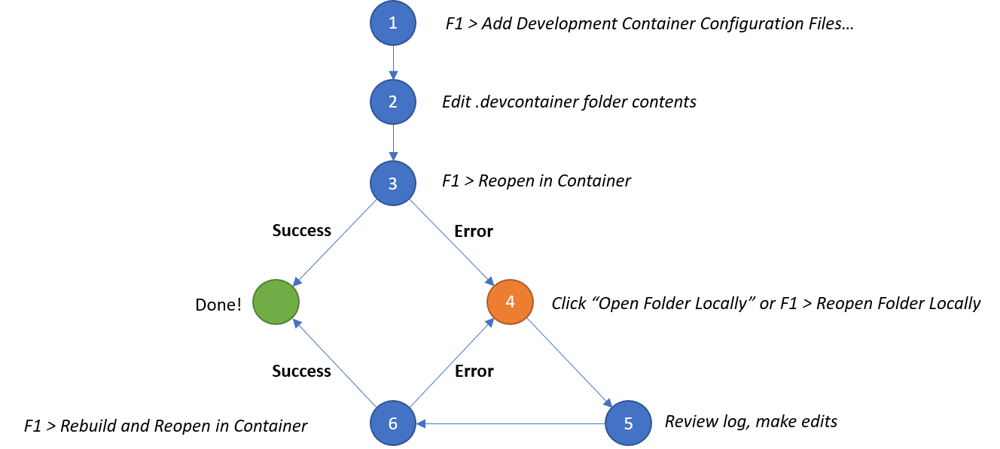
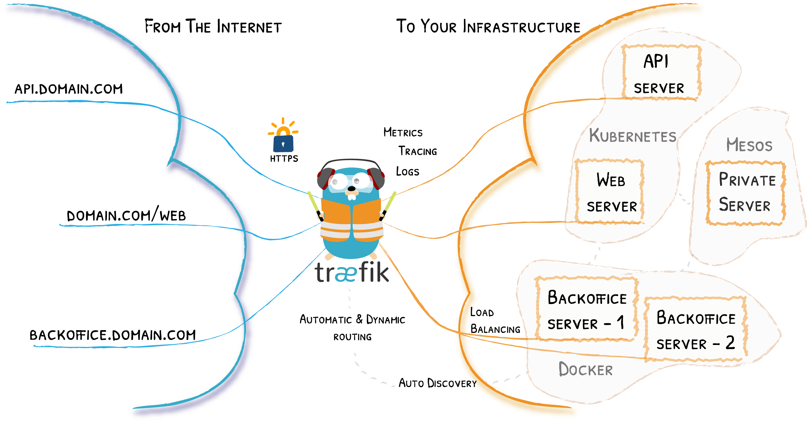
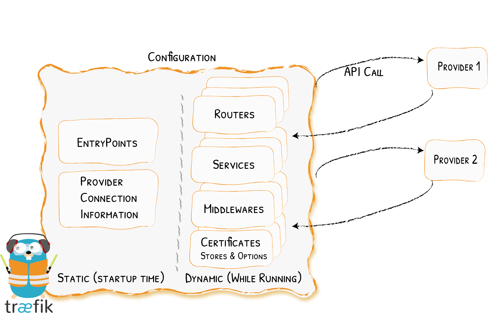

# Cursus DevOps

- [Cursus DevOps](#cursus-devops)
  - [Hoofdstuk 1: De DevOps Filosofie](#hoofdstuk-1-de-devops-filosofie)
    - [1.1 Het probleem van vroeger](#11-het-probleem-van-vroeger)
    - [1.2 Wat is DevOps?](#12-wat-is-devops)
    - [1.3 De DevOps Toolchain](#13-de-devops-toolchain)
  - [Hoofdstuk 2: Versiebeheer met Git](#hoofdstuk-2-versiebeheer-met-git)
    - [2.1 De Drie Fases van Git](#21-de-drie-fases-van-git)
    - [2.2 Basis Commando's en Workflow](#22-basis-commandos-en-workflow)
    - [2.3 Samenwerken (Remote Repositories)](#23-samenwerken-remote-repositories)
    - [2.4 Navigeren en Wijzigingen Ongedaan Maken](#24-navigeren-en-wijzigingen-ongedaan-maken)
    - [2.5 Bestanden Negeren (.gitignore \& exclude)](#25-bestanden-negeren-gitignore--exclude)
  - [Hoofdstuk 3: Containerization (Docker)](#hoofdstuk-3-containerization-docker)
    - [3.1 Waarom Containers? (VM's vs. Containers)](#31-waarom-containers-vms-vs-containers)
    - [3.2 Isolatie onder de motorkap](#32-isolatie-onder-de-motorkap)
    - [3.3 Images vs. Containers](#33-images-vs-containers)
    - [3.4 De Dockerfile (Zelf Images Bouwen)](#34-de-dockerfile-zelf-images-bouwen)
    - [3.5 De Docker Socket (Concept \& Beveiligingsrisico)](#35-de-docker-socket-concept--beveiligingsrisico)
    - [3.6 Meerdere commando's uitvoeren (De `bash -c` truc)](#36-meerdere-commandos-uitvoeren-de-bash--c-truc)
  - [Hoofdstuk 4: Praktijk \& Multi-Container Applicaties](#hoofdstuk-4-praktijk--multi-container-applicaties)
    - [4.1 Basis Docker Commando's (CLI)](#41-basis-docker-commandos-cli)
    - [4.2 Volumes en Data Persistentie](#42-volumes-en-data-persistentie)
    - [4.3 Docker Compose](#43-docker-compose)
    - [4.4 Interne DNS \& Netwerken](#44-interne-dns--netwerken)
    - [4.5 Veilige Configuratie (.env \& Secrets)](#45-veilige-configuratie-env--secrets)
    - [4.6 Docker Networking (Communicatie tussen containers)](#46-docker-networking-communicatie-tussen-containers)
    - [4.7 Docker Logs (Logging \& Observability)](#47-docker-logs-logging--observability)
  - [Hoofdstuk 5: DevContainers (Ontwikkelomgevingen)](#hoofdstuk-5-devcontainers-ontwikkelomgevingen)
    - [5.1 Wat is een DevContainer?](#51-wat-is-een-devcontainer)
    - [5.2 Opzet via Visual Studio Code](#52-opzet-via-visual-studio-code)
    - [5.3 Configuratie en Automatisatie (devcontainer.json)](#53-configuratie-en-automatisatie-devcontainerjson)
  - [Hoofdstuk 6: Reverse Proxies \& Traefik](#hoofdstuk-6-reverse-proxies--traefik)
    - [6.1 Wat is een Reverse Proxy?](#61-wat-is-een-reverse-proxy)
    - [6.2 Kernconcepten van Traefik](#62-kernconcepten-van-traefik)
    - [6.3 Statische vs. Dynamische Configuratie](#63-statische-vs-dynamische-configuratie)
    - [6.4 Traefik YAML in de Praktijk (De Configuratie Ontleed)](#64-traefik-yaml-in-de-praktijk-de-configuratie-ontleed)
    - [6.5 TLS \& HTTPS (Beveiligd Verkeer)](#65-tls--https-beveiligd-verkeer)
  - [Auteursrecht \& Verantwoording](#auteursrecht--verantwoording)
<div style="page-break-after: always;"></div>

## Hoofdstuk 1: De DevOps Filosofie

### 1.1 Het probleem van vroeger
Vroeger ging een toepassing tijdens de ontwikkeling meermaals over en weer tussen verschillende afgescheiden partijen: Development (ontwikkelaars), Operations (beheerders) en QA (Quality Assurance). Dit 'muurtje' tussen de afdelingen zorgde voor veel problemen, technische uitdagingen en discussies. 

### 1.2 Wat is DevOps?
Om deze problemen op te lossen, is DevOps gevormd als een overkoepelende discipline die de samenwerking verbetert. Hoewel DevOps meer vergt van alle betrokken partijen dan hun oorspronkelijke afzonderlijke taken, resulteert het in een veel betere kwaliteit van de software. Het hoofddoel van DevOps is het stroomlijnen en automatiseren van de volledige ontwikkelings- en release-flow (de *loop*).
De belangrijkste filosofie binnen DevOps is: **"You build it = you run it"**.


### 1.3 De DevOps Toolchain
Binnen DevOps gebruiken we verschillende tools voor specifieke fases van de loop (hoewel er per fase veel alternatieven bestaan):
* **Git:** Voor de "Create & Verify" fase (versiebeheer).
* **Docker:** Voor de "Package & Release" fase (containerization).
* **Docker Compose:** Voor de "Configure & Monitor" fase (applicaties samenstellen).


---
<div style="page-break-after: always;"></div>

## Hoofdstuk 2: Versiebeheer met Git

Git is een open-source tool voor versiebeheer die oorspronkelijk is ontstaan tijdens de ontwikkeling van de Linuxkernel. In essentie laat Git ons toe om gestructureerd back-ups (versies) bij te houden om fouten te voorkomen en terug te kunnen keren in de tijd. 
*Let op:* Git is de achterliggende technologie, GitHub is een website/platform dat Git-diensten aanbiedt.



### 2.1 De Drie Fases van Git
Het basisprincipe van Git steunt op drie statussen of 'fases' waarin een bestand zich kan bevinden:
1. **Lokale map (Working Directory):** Hier bewaar en bewerk je de bestanden lokaal.
2. **Staging area:** Hier zet je de specifieke wijzigingen klaar die je in de volgende versie wilt opnemen.
3. **Git map (Repository):** Hier worden de wijzigingen definitief weggeschreven als een nieuw checkpoint.

### 2.2 Basis Commando's en Workflow
* `git init`: Activeert Git en maakt een verborgen `.git`-folder aan binnen je project. Maak nooit een nieuwe Git-folder aan in een submap als de hoofdmap al een Git-folder bevat. Bij fatale fouten kun je deze folder verwijderen en de remote repository opnieuw *clonen*.
* `git status`: Toont de huidige status van je versiebeheer. Met de `-u` vlag krijg je meer gedetailleerde informatie. Als je *'working tree clean'* ziet, zijn je lokale bestanden exact hetzelfde als de laatste opgeslagen versie.
* `git add <filenaam>`: Verplaatst een 'untracked file' of wijziging van fase 1 naar de staging area (fase 2).
* `git commit -m "boodschap"`: Slaat de bestanden uit de staging area definitief op in de repository (fase 3) met een beschrijvende boodschap. Elke commit krijgt een unieke hashcode ter identificatie en veiligheid. Hierdoor kan je heel specifiek versies bijhouden (bijvoorbeeld een versie mét en zonder een bepaalde feature, zonder halfafgewerkte code daartussenin).
* `git log`: Toont het logboek van alle commits met info over de auteur en datum. De meest recente commit staat bovenaan. Handige opties:
  * `--oneline`: Toont enkel de belangrijkste informatie compact.
  * `--graph`: Toont een visuele boomstructuur (handig bij vertakkingen/branches).
  * `--abbrev-commit`: Toont verkorte hashcodes.

### 2.3 Samenwerken (Remote Repositories)
Git ondersteunt het werken met een lokale én een remote repository, waardoor je met meerdere personen aan hetzelfde project kan werken.
* `git remote -v`: Toont de URL van de gekoppelde remote repository.
* `git push`: Stuurt je lokale commits naar de remote repository. Dit maakt aanpassingen definitiever omdat ze nu gedeeld zijn met derden. (Tip: maak voor een push even een back-up van je projectmap).
* `git pull` / `git fetch`: Haalt wijzigingen van de remote repository naar jouw lokale machine.
* **Issues koppelen:** Als je een issue oplost, kan je het issuenummer in je commit-message vermelden zodat deze automatisch wordt gesloten, of de commit-hash manueel in de comments van het issue plaatsen.


### 2.4 Navigeren en Wijzigingen Ongedaan Maken
* `git diff`: Toont de exacte verschillen tussen verschillende commits.
* `git checkout`: Hiermee keer je terug naar een eerdere commit om zaken te controleren, zonder dat de nieuwere commits verwijderd worden (je gaat terug naar fase 1).
* `git reset`: Wordt gebruikt om wijzigingen ongedaan te maken.
  * `git reset --soft HEAD^`: Maakt de tracking (commit) ongedaan, maar behoudt je gewijzigde bestanden lokaal.
  * `git reset --hard HEAD^`: Gooit ook de lokale wijzigingen in je bestanden weg en herstelt de bestanden naar de exacte staat van vóór de commit.
* `git tag`: Voegt een leesbare naam toe aan een specifieke commit (naast de hashcode). Je kan meerdere tags aan één commit toevoegen. Met `git show <tag>` vind je de commit en de bijbehorende boodschap makkelijk terug.

### 2.5 Bestanden Negeren (.gitignore & exclude)
Niet alles hoort thuis in versiebeheer, zoals persoonlijke notities of gevoelige bestanden met wachtwoorden. Je moet bestanden negeren *voordat* je een commit doet, anders worden ze al getracked.
* `.gitignore`: Een bestand waarin je regels en *wildcards* plaatst om bepaalde bestanden uit te sluiten. Dit bestand geldt voor het hele team en wordt wél mee gecommit.
* `.git/info/exclude`: Vergelijkbaar met `.gitignore`, maar dit geldt enkel lokaal voor jezelf en wordt niet gedeeld met anderen.

*Troubleshooting note:* Bij het toevoegen van bestanden kan Git een waarschuwing geven over "LF vs CRLF". Dit komt door het verschil in regeleindes tussen Linux en Windows en kan later problemen geven bij het werken met Docker containers.

---
<div style="page-break-after: always;"></div>

## Hoofdstuk 3: Containerization (Docker)

### 3.1 Waarom Containers? (VM's vs. Containers)
Vroeger werden applicaties rechtstreeks op een server geïnstalleerd. Dit gaf problemen met *dependencies* (afhankelijkheden): als app A versie 1 van een bestand nodig had en app B versie 2, ontstonden er conflicten. De oplossing was vroeger om voor elke app een aparte server te voorzien, wat ontzettend duur en inefficiënt is.

**Virtual Machines (VM's) als eerste oplossing**
Met behulp van een *Hypervisor* konden we één fysieke server opdelen in meerdere Virtual Machines. Elke VM draait een volledig eigen besturingssysteem (Guest OS) en is strikt gescheiden van de rest. 
*   *Nadeel:* VM's zijn erg resource-intensief, traag om op te starten en niet altijd gebruiksvriendelijk voor developers.

**Containers als moderne oplossing**
Een *Container Engine* (zoals Docker) virtualiseert niet de hardware, maar deelt het besturingssysteem (OS) van de host. 
*   VM's splitsen de hardware via een Hypervisor.
*   Containers splitsen het File System (FS), de netwerkstack en processen via de Container Runtime, maar delen de OS-kernel met de host.
*   *Gevolg:* Containers zijn razendsnel, lichtgewicht, maar iets minder strikt geïsoleerd dan VM's. Je kunt hierdoor ook geen Windows-containers draaien op een Linux-host of omgekeerd (tenzij je tools als WSL gebruikt op Windows).

### 3.2 Isolatie onder de motorkap
Hoewel containers het OS delen, mogen ze elkaars processen (of die van de host) niet verstoren of "killen". Linux bereikt deze isolatie via twee kerntechnologieën:
1.  **Namespaces:** Zorgen voor isolatie. Ze bepalen wat een container *kan zien* (bijv. zijn eigen virtuele netwerk, zijn eigen processen).
2.  **Cgroups (Resource Limitation):** Zorgen voor limieten. Ze bepalen wat een container *kan gebruiken* (bijv. maximaal 512MB RAM of 1 CPU-core).

### 3.3 Images vs. Containers
In Docker is er een strikt onderscheid tussen een Image en een Container:
*   **Image:** Een onveranderlijk (read-only) sjabloon dat de applicatiecode, libraries en dependencies bevat. Vergelijkbaar met een **Klasse** in objectgeoriënteerd programmeren.
*   **Container:** Een draaiende instantie van een image. Vergelijkbaar met een **Object**. Je kunt vanuit één image talloze identieke containers opstarten.

<div style="page-break-after: always;"></div>

### 3.4 De Dockerfile (Zelf Images Bouwen)
Een `Dockerfile` is een tekstdocument met instructies om een image te bouwen. Docker leest dit bestand van boven naar onder. Om onnodige bestanden (zoals lokale `node_modules`) buiten de image te houden, gebruik je een `.dockerignore` bestand.

**Belangrijke Dockerfile instructies:**
*   `FROM <image>`: Bepaalt de basislaag (bijv. `node:latest` of `debian`). Moet altijd als eerste staan.
*   `WORKDIR <pad>`: Maakt een werkmap aan in de container en voert alle volgende commando's daarbinnen uit.
*   `COPY <bron> <doel>`: Kopieert bestanden van je lokale pc naar de container (bijv. `COPY . .` kopieert alles naar de WORKDIR).
*   `RUN <commando>`: Voert een commando uit *tijdens het bouwen* (build-time) van de image (bijv. `RUN npm install` of `RUN dotnet restore`).
*   `EXPOSE <poort>`: Documenteert op welke poort de container luistert. Dit is informatief voor de developer en opent geen poorten naar de buitenwereld.
*   `USER <naam|uid>`: Zorgt dat de container niet als de default `root`-gebruiker draait, wat cruciaal is voor veiligheid.
*   `CMD <commando>`: Het commando dat wordt uitgevoerd *wanneer de container start* (run-time). In tegenstelling tot `RUN` gebeurt dit pas als de image al af is. (Bijv. `CMD ["npm", "start"]` of `CMD sleep infinity` om de container gewoon levend te houden).

**Best Practice: Layer Caching & Multistage Builds**
Elke regel in een Dockerfile creëert een 'laag' (layer). Docker hergebruikt lagen die niet gewijzigd zijn om het bouwen te versnellen (caching).
*   *Tip:* Kopieer eerst je dependency-bestanden (zoals `package.json`), doe een `RUN npm install`, en kopieer pas daarna de rest van je code (`COPY . .`). Als je dan je code wijzigt, hoeft Docker niet telkens alle packages opnieuw te downloaden.
*   *Multistage Builds:* Je kunt in één Dockerfile meerdere `FROM` statements gebruiken. Hierdoor kun je bijvoorbeeld de zware SDK gebruiken om je code te compileren, en enkel het resulterende, lichte uitvoerbare bestand (via `COPY --from=BUILD`) meenemen naar een schone, lichte productie-image. Dit houdt je uiteindelijke image klein.

### 3.5 De Docker Socket (Concept & Beveiligingsrisico)
Wanneer je met de Docker CLI (Command Line Interface) commando's typt zoals `docker run` of `docker ps`, communiceert jouw terminal eigenlijk met de achterliggende 'Docker Daemon' (de achtergrondservice die het zware werk doet). Deze communicatie verloopt via de **Docker Socket**, een speciaal bestand dat standaard te vinden is op `/var/run/docker.sock`.
<div style="page-break-after: always;"></div>

**Waarom zou je deze socket delen met een container?**
Sommige applicaties hebben informatie nodig over andere containers op jouw systeem. Een perfect voorbeeld hiervan is Traefik (zie Hoofdstuk 6). Traefik moet dynamisch weten wanneer er nieuwe web-containers opstarten of stoppen om de routing rules aan te passen. Door de Docker socket als een volume aan de Traefik-container te koppelen (`-v /var/run/docker.sock:/var/run/docker.sock`), geef je die container de mogelijkheid om rechtstreeks tegen de Docker Daemon van de host te praten.

**Het Beveiligingsrisico (Security Warning)**
Je mag de Docker socket **nooit zomaar meegeven in eender welke container**. Het geeft de container namelijk vergaande rechten:
*   Een container met toegang tot de Docker socket kan API-verzoeken sturen naar de host en zo nieuwe containers opstarten, verwijderen of images downloaden.
*   Dit kan leiden tot *Privilege Escalation*: een hacker die in zo'n container weet binnen te dringen, kan de socket gebruiken om toegang te verlenen aan de volledige lokale host. Dit staat nagenoeg gelijk aan het geven van *root-toegang* tot je machine.
*   **Conclusie:** Koppel de Docker socket alléén aan zeer specifieke, vertrouwde containers (zoals je reverse proxy of monitoring tools) die absoluut niet zonder kunnen om te functioneren.

### 3.6 Meerdere commando's uitvoeren (De `bash -c` truc)
Wanneer je een container definieert, mag je in een Dockerfile standaard maar één `CMD` instructie gebruiken om het startcommando te bepalen. Maar wat als je applicatie vereist dat er eerst een migratie draait, en pas daarna de webserver start? 

Om meerdere commando's sequentieel uit te voeren, gebruik je de `bash -c` truc. Je roept de bash-shell aan en geeft een string (tekenreeks) mee met daarin meerdere commando's, gescheiden door `&&`. 
*   **De werking van `&&`:** Dit zorgt ervoor dat een volgend commando pas wordt uitgevoerd als het voorgaande succesvol (zonder fouten) is afgerond.
*   **Voorbeeld:** `CMD ["bash", "-c", "npm run migrate && npm start"]`

Deze techniek is ook bijzonder handig bij het instellen van DevContainers of complexe Docker Compose opstellingen waarbij meerdere initialisatiestappen nodig zijn.

---
<div style="page-break-after: always;"></div>

## Hoofdstuk 4: Praktijk & Multi-Container Applicaties

### 4.1 Basis Docker Commando's (CLI)
Tijdens de ontwikkeling gebruik je vaak de Docker Command Line Interface (CLI).
*   `docker run <image>`: Start een container op basis van een image.
    *   `-d`: Detached mode (draait op de achtergrond).
    *   `--name <naam>`: Geeft de container een eigen naam.
    *   `--rm`: Verwijdert de container automatisch zodra deze stopt (voorkomt "lingering" containers).
    *   `-p <host-poort>:<container-poort>`: Mapt een poort op jouw pc naar de poort in de container. (Bijv. `-p 8080:80` zorgt dat je via `localhost:8080` bij poort 80 van de container komt).
    *   `-e <KEY>=<VALUE>`: Geeft omgevingsvariabelen (environment variables) mee (bijv. database wachtwoorden).
*   `docker exec -it <container> bash`: Geeft je een interactieve terminal (`-it`) binnenin een draaiende container om commando's (zoals in `bash` of `sh`) uit te voeren.

### 4.2 Volumes en Data Persistentie
Containers zijn 'stateless' en vluchtig: als een container stopt of wordt verwijderd, is alle data die erin zat onherroepelijk weg. Om data (zoals een database of een gastenboek-bestand) te behouden, gebruiken we externe opslag. Er zijn twee hoofdmethodes:

1.  **Bind Mounts:** Mapt een specifieke map op jouw fysieke harde schijf rechtstreeks naar een map in de container (`-v $(pwd):/app`). 
    *   Handig tijdens development: als je lokaal een bestand opslaat, ziet de container de wijziging direct.
    *   Je kan deze ook read-only maken (`:ro`) zodat de container de data wel kan lezen, maar niet kan overschrijven (vaak gebruikt voor het maken van tar-backups).
2.  **Docker Volumes:** Een opslagruimte die volledig door Docker zelf wordt beheerd (`docker volume create <naam>`). Wordt gebruikt voor databases in productie omdat dit veel veiliger en onafhankelijk van het host-OS is. (Gebruik via `-v <volumenaam>:<container-pad>`).

### 4.3 Docker Compose
Als applicaties uit meerdere componenten bestaan (bijv. een frontend, een backend API en een MySQL database), wordt het ondoenlijk om deze allemaal handmatig via lange `docker run` commando's op te starten.
**Docker Compose** lost dit op via één enkel `docker-compose.yml` bestand, waarin je alle containers (*services*), netwerken en volumes definieert.

**Structuur van een YAML bestand:**
```yaml
services:
  backend-api:
    build: .                 # Bouwt de image op basis van de lokale Dockerfile
    ports:
      - "3000:3000"          # Host:Container poort mapping
    depends_on:
      - databank             # Zorgt dat de backend pas start NA de database

  databank:
    image: mysql:9.7.1       # Gebruikt een kant-en-klare image van DockerHub
    volumes:
      - db-data:/var/lib/mysql # Gebruikt een Docker volume voor persistentie
    env_file:
      - .env                 # Laadt gevoelige data in via een apart .env bestand

volumes:
  db-data:                   # Definieert het algemene volume
```

### 4.4 Interne DNS & Netwerken
Een van de krachtigste features van Docker Compose is dat het automatisch een intern netwerk aanmaakt voor alle services in het YAML-bestand (netwerken kan je algemeen definiëren en dan specifiek aan een service toewijzen). 
*   **Service Discovery:** Bij het runnen van containers kunnen services elkaar herkennen op naam; dit is eigenlijk een intern DNS-systeem van Docker. 
*   Voorbeeld: In de applicatiecode vul je bij de host voor de database gewoon de servicenaam in (bijv. `databank`) in plaats van te moeten werken met een veranderlijk IP-adres.

### 4.5 Veilige Configuratie (.env & Secrets)
Het is geen 'good practice' om omgevingsvariabelen (environment variables) met gevoelige gegevens leesbaar direct in het configuratiebestand te plaatsen. 
*   **Omgevingsvariabelen (.env):** We werken daarom met een apart `.env` bestand. In het YML-bestand werken we dan met *interpolatie*, waardoor de variabelen uit de `.env` dynamisch worden ingevuld (als de variabele in de `.env` niet gevonden kan worden, wordt een lege string ingevuld).
*   **Gitignore:** Via de `.gitignore`-file kan dit `.env` bestand, en dus de variabelen, veilig uit versiebeheer gehouden worden.
*   **Secrets:** Voor zeer gevoelige data kunnen ook *Secrets* gebruikt worden om gerichter kwetsbare data mee te geven. Dit werkt vergelijkbaar met volumes en netwerken en maakt de kans op het onbedoeld loggen van gevoelige gegevens nog veel kleiner.

### 4.6 Docker Networking (Communicatie tussen containers)
Containers zijn standaard sterk geïsoleerd. Om twee losse containers met elkaar te laten praten (bijvoorbeeld een webserver en een database), moeten ze zich in hetzelfde virtuele Docker-netwerk bevinden. 

Hoewel Docker Compose dit netwerkbeheer volledig automatiseert, is het belangrijk om dit ook manueel via de CLI te kunnen opzetten en debuggen:
*   `docker network create <netwerk-naam>`: Maakt een nieuw, geïsoleerd virtueel netwerk aan.
*   `docker run --network <netwerk-naam> <image>`: Start een container en koppelt deze direct aan het gespecificeerde netwerk.
*   `docker network inspect <netwerk-naam>`: Geeft een gedetailleerd overzicht (in JSON) van het netwerk, inclusief welke containers er momenteel mee verbonden zijn en welke interne IP-adressen ze hebben gekregen.

### 4.7 Docker Logs (Logging & Observability)
Omdat we containers in de praktijk bijna altijd op de achtergrond draaien (via de `-d` of *detached* vlag), zie je de output van je applicatie niet meer in je terminal verschijnen. Toch is het verzamelen van logs essentieel voor *observability* (het monitoren van je applicatie) en het opsporen van fouten.

*   **Logs bekijken:** Met het commando `docker logs <container-naam of id>` haal je de volledige output (stdout en stderr) van een specifieke container op. Dit is je eerste redmiddel als een container onverwacht crasht of weigert te starten.
*   **Beveiliging in logs:** Zorg ervoor dat wachtwoorden en API-keys nooit zomaar in de applicatie-output worden geprint. Dit is precies de reden waarom we werken met *Secrets* en *Environment Variables* (`.env`): ze voorkomen dat kwetsbare gegevens leesbaar en permanent in je Docker logs (of Git-geschiedenis) belanden.

---  
<div style="page-break-after: always;"></div>

## Hoofdstuk 5: DevContainers (Ontwikkelomgevingen)

### 5.1 Wat is een DevContainer?
Een DevContainer is een afgesloten omgeving specifiek voor ontwikkeling. Dit is erg handig omdat het garandeert dat alle werknemers binnen een project in exact dezelfde omgeving werken met identieke software en dependencies. Het blijft in essentie een aparte Docker container, maar dan eentje waarin extra tools voor development worden geïnstalleerd.


### 5.2 Opzet via Visual Studio Code
De meest courante manier om met DevContainers te werken is via VS Code.
*   **Installatie:** Maak gebruik van de *Dev Containers* extensie (uitgegeven door Microsoft).
*   **Configuratie:** Je maakt een `.devcontainer` folder aan met daarin een `devcontainer.json` bestand. Dit bestand maakt nog altijd gebruik van een achterliggende Dockerfile, maar voegt er extra JSON-regels aan toe (waarbij er soms overlap is tussen deze regels en de Dockerfile).
*   **Opstarten:** Via de commando's in VS Code kies je voor *Reopen in Container*.

### 5.3 Configuratie en Automatisatie (devcontainer.json)
In het `devcontainer.json` bestand kan je de ontwikkelomgeving volledig naar je hand zetten:
*   **Extensies toevoegen:** Je kan VS Code extensies (zoals Prisma) toevoegen aan het `"customizations"` blok, zodat deze automatisch geïnstalleerd zijn voor elke developer die de container opent.
*   **Koppelen aan Docker Compose:** In plaats van een losse image op te starten, kan je de DevContainer baseren op je bestaande `docker-compose.yml`. Je verwijdert dan de `"image"` regel en voegt `"dockerComposeFile"`, de specifieke `"service"` (bijv. "app") en de `"workspaceFolder"` toe.
*   **Automatisatie (postCreateCommand):** Dit is een commando dat automatisch wordt uitgevoerd nadat de container is aangemaakt. Dit is ideaal om bijvoorbeeld direct de packages te installeren en een database te seeden (bijv. `"postCreateCommand": "cd api && npm install && npx prisma db push && npx prisma db seed"`).

*Opmerking:* Naast DevContainers bestaat er ook het concept van een *multistage build* (Dockercontainers in Dockercontainers aanmaken), waarbij bestanden gekopieerd worden van een Dockercontainer in plaats van het hostsysteem.

---
<div style="page-break-after: always;"></div>

## Hoofdstuk 6: Reverse Proxies & Traefik

### 6.1 Wat is een Reverse Proxy?
Een proxy fungeert als een plaatsvervanger. 
*   **Forward proxy:** Je laat het werk door iemand anders doen.
*   **Reverse proxy:** Dit is een "verkeersagent" die vóór je andere servers staat, het inkomende verkeer sorteert en doorstuurt naar de juiste plaats.

**Voordelen van een Reverse Proxy:**
*   Fungeert als middleware.
*   **Load balancing:** Taken worden over meerdere servers verspreid zodat deze niet worden overbelast (de gebruiker merkt hier niets van).
*   Het werkt het best voor webverkeer en maakt veilige HTTPS-verbindingen mogelijk, waarbij het vernieuwen van certificaten tegenwoordig veel eenvoudiger en geautomatiseerd verloopt.

### 6.2 Kernconcepten van Traefik
Traefik is een populaire reverse proxy voor containers. Het is belangrijk om Traefik altijd up-to-date te houden om de nieuwste standaarden te blijven hanteren. Traefik hanteert een routetabel vergelijkbaar met netwerkrouters, maar werkt op basis van andere parameters in plaats van IP-adressen.
Traefik bouwt op de volgende kernconcepten:
*   **Entrypoints:** De poort waarlangs je bij Traefik binnenkomt (typisch zijn dit de UDP, TCP of HTTP(S) protocollen).
*   **Routers:** Inspecteren het verkeer en sturen dit op een hoger niveau door. Ze sturen het verkeer van een bepaald entrypoint door naar de juiste service.
*   **Services:** Dit zijn de eindbestemmingen voor het verkeer (deze komen vaak, maar niet noodzakelijk, overeen met de services in je Docker Compose). (Een service zoals `whoami` kan bijvoorbeeld bijhouden wie de services heeft bezocht).
*   **Middleware:** Kan gebruikt worden om extra bewerkingen op het verkeer uit te voeren.


### 6.3 Statische vs. Dynamische Configuratie
Traefik maakt een strikt onderscheid tussen twee soorten configuratie:
1.  **Statische configuratie (startup):** Dit is de basisconfiguratie die hetzelfde blijft zolang de proxy bestaat en draait.
2.  **Dynamische configuratie:** Dit is de routing configuratie die dynamisch kan wijzigen. Binnen een Docker-omgeving doe je dit standaard door middel van **Docker labels** die je aan je applicatie-containers hangt.


### 6.4 Traefik YAML in de Praktijk (De Configuratie Ontleed)
Om Traefik als reverse proxy voor je Docker-containers in te stellen, gebruik je een specifieke `docker-compose.yml` structuur. Laten we het voorbeeld stap voor stap ontleden:

**1. De Traefik Service (`reverse-proxy`)**
*   **`image: traefik:v3.2`**: We trekken de officiële Traefik image binnen.
*   **`command`**: Hier definiëren we de *statische configuratie* van Traefik zelf.
    *   `--api.insecure=true`: Zet de web UI (het Traefik-dashboard) onbeveiligd open, zodat je lokaal visueel kan volgen welke services gekoppeld zijn.
    *   `--providers.docker`: Vertelt Traefik dat het naar Docker moet "luisteren" om nieuwe containers volautomatisch te detecteren.
*   **`ports`**: 
    *   `"80:80"`: Ontvangt al het standaard inkomende webverkeer.
    *   `"8080:8080"`: Maakt het dashboard lokaal bereikbaar via poort 8080 (werkt in combinatie met de `api.insecure` flag).
*   **`volumes`**: 
    *   `/var/run/docker.sock:/var/run/docker.sock`: **Cruciaal!** Dit geeft Traefik toegang tot de Docker API, zodat het kan zien welke containers starten of stoppen en hun labels kan lezen. *Let op (zoals gezien in de theorie): Geef de Docker socket niet zomaar aan eender welke container, want dit kan diepe toegang verlenen aan je lokale host!*

**2. Een Doel-Service (`whoami`)**
*   **Geen poorten!** Merk op dat we bij de `whoami`-container geen `ports` definiëren. Omdat de reverse proxy (Traefik) en de service in hetzelfde Docker-netwerk zitten, praten ze intern met elkaar. De service zelf hoeft dus niet open te staan naar de buitenwereld.
*   **`labels`**: Hier gebeurt de *dynamische configuratie*. 
    *   `- "traefik.http.routers.whoami.rule=Host(\`whoami.localhost\`)"`: Deze regel plakt een label op de container dat Traefik kan lezen. Het zegt: *"Als er een HTTP-verzoek binnenkomt voor de specifieke domeinnaam `whoami.localhost`, stuur dit verkeer dan door naar deze container."*

### 6.5 TLS & HTTPS (Beveiligd Verkeer)
Standaard HTTP-verkeer (over poort 80) is onversleuteld en daardoor onveilig. Om het verkeer te beveiligen, gebruiken we TLS (Transport Layer Security), wat resulteert in een beveiligde HTTPS-verbinding.

*   **De evolutie:** Vroeger was het instellen van HTTPS voor eigen applicaties een enorme klus, vooral omdat beveiligingscertificaten handmatig aangevraagd, geïnstalleerd en (niet te vergeten) geüpdatet moesten worden.
*   **Moderne aanpak met Traefik:** Tegenwoordig is dit veel eenvoudiger. Traefik heeft ingebouwde mechanismen om volautomatisch certificaten (bijvoorbeeld via Let's Encrypt) aan te vragen en te vernieuwen. Je voegt simpelweg een paar extra labels toe aan je container, en Traefik regelt achter de schermen het hele proces. Hierdoor is je applicatie moeiteloos en standaard voorzien van een veilig, groen slotje.

---
<div style="page-break-after: always;"></div>

## Auteursrecht & Verantwoording
© 2026 Gonnissen Niels. Alle rechten voorbehouden.

Deze cursus is onafhankelijk samengesteld en geschreven als studiemateriaal voor het vak DevOps. De theorie en praktijkvoorbeelden zijn gebaseerd op persoonlijke les- en labonotities, die vervolgens iteratief zijn gestructureerd, verfijnd en uitgebreid met de hulp van Google Gemini als technische co-auteur.

Het delen en verspreiden van dit document onder medestudenten ter ondersteuning van hun studies is toegestaan en wordt aangemoedigd, mits deze bronvermelding intact blijft.